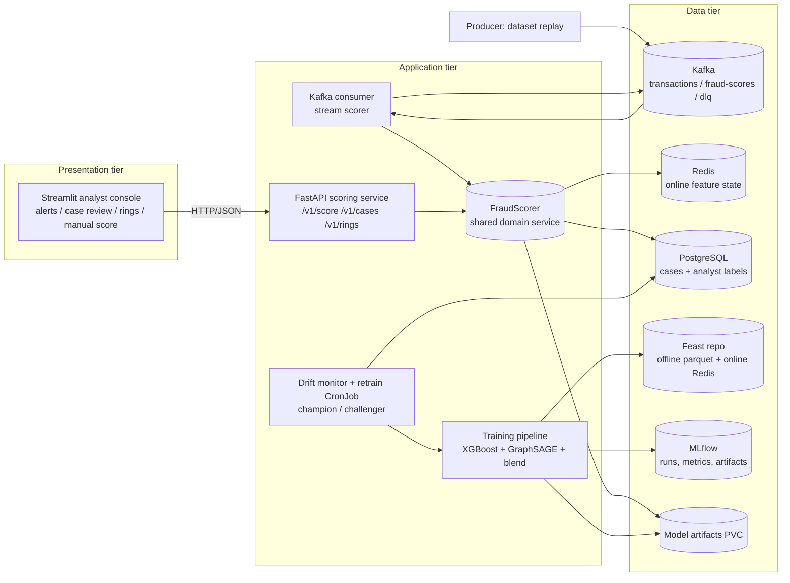
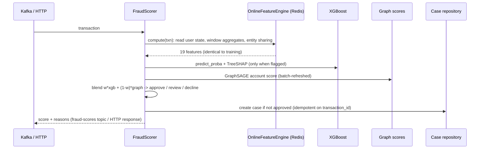

# AIML-01 Architecture

## Three-tier view

The presentation tier talks **only** to the API; the API and the consumer share
one domain object (`FraudScorer`) so HTTP and streaming decisions can never
diverge; all state lives in the data tier so application pods are stateless
and horizontally scalable (HPA 2 to 10 replicas).

## Scoring path (one transaction, ~1 ms p50)

## Key design decisions

| Decision | Why |
|---|---|
| Single feature definition module + parity test | Training/serving skew is the #1 production ML bug. `test_online_matches_offline_exactly` replays 4k events through the streaming engine and asserts equality with the batch features. |
| Point-in-time features, temporal split | Random splits leak future behaviour; `test_no_future_leakage` proves appending future data never changes past features. |
| PR-AUC, recall@precision 90%, precision@top-1% | Accuracy is 99.5% for a do-nothing model at 0.5% fraud. Top-1% matches analyst review capacity. |
| `scale_pos_weight` default, SMOTE optional | Weighting is cheaper and avoids synthetic-sample artefacts; SMOTE is applied to the training fold only. |
| Inductive GraphSAGE | Trained on the training-period graph, applied to the full graph, so new accounts get scores without retraining. |
| Convex blend fitted on validation | One interpretable parameter; tie-break favours XGBoost (no graph lookup needed). |
| User-keyed Kafka partitions | Preserves per-user ordering, which stateful velocity features require. |
| At-least-once + idempotent cases + DLQ | Consumer commits after producing; duplicates are safe; poison messages don't stall the stream. |
| Champion/challenger promotion | Automatic retraining can never silently ship a worse model. |

## Known limitations

* Graph scores are refreshed in batch; the offline evaluation uses an end-of-period
  graph snapshot, so the GNN numbers are an optimistic upper bound for a
  real-time setting. A streaming graph store (e.g. Neo4j/TigerGraph) is the next step.
* The demo Kafka runs as a single broker; production would use Strimzi with 3 brokers and RF=3.
