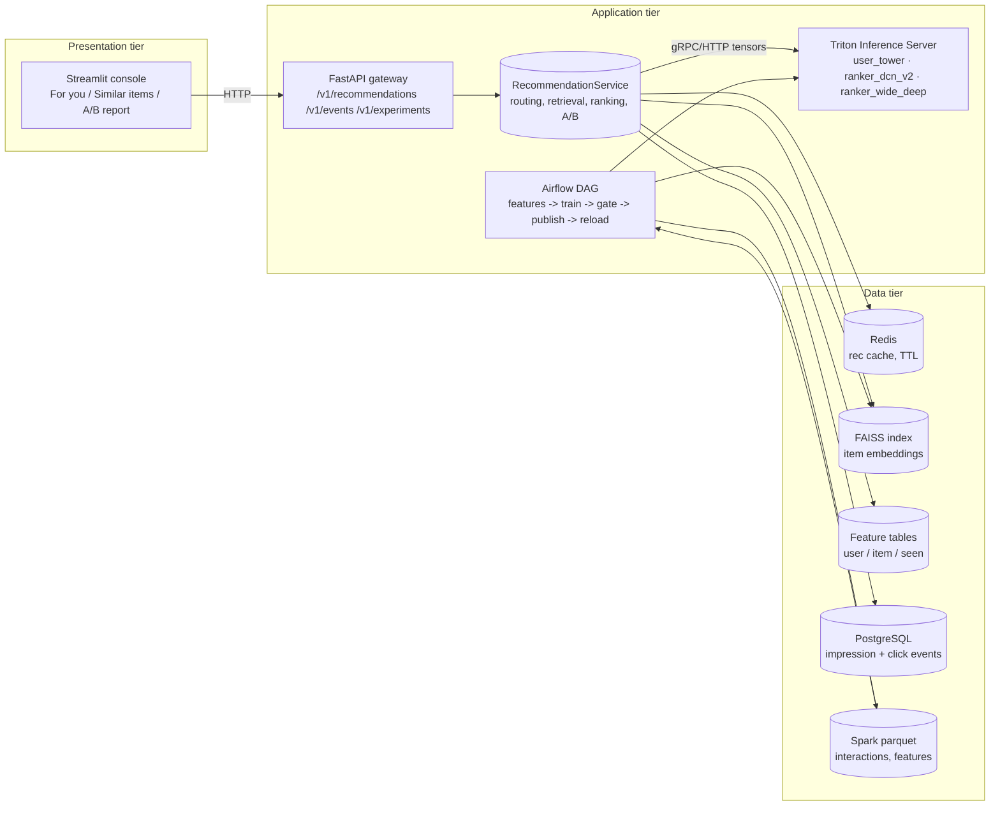
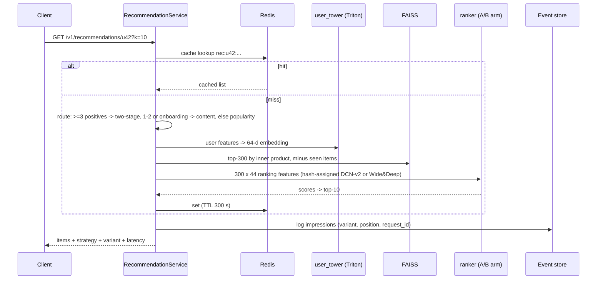

# AIML-03 Architecture

## Three-tier view



## Online request path (p50 4.3 ms, p99 6.7 ms in-process; 0.03 ms cache hit)



## Offline pipeline and timeline

```
|---------------- train ----------------|----- val -----|----- test -----|
                                        t1              t2
two-tower: fit on train positives, features as of t1 (point-in-time histories)
rankers  : fit on val-window labels over two-tower top-200 candidates
serving  : features rebuilt as of t2 with the *same id vocabulary*; evaluated on test
```

## Key design decisions

| Decision | Why |
|---|---|
| Global temporal split | Random splits let models train on a user's future; temporal split also produces real cold-start users. |
| Point-in-time training histories | `test_retrieval_examples_never_see_their_target` guarantees the target never appears in its own history. |
| In-batch softmax with log-Q correction | Popular items appear more often as in-batch negatives; log-Q correction removes that bias. Accidental hits are masked. |
| ID dropout in the user tower | Forces the tower to use history and taste features, so new users (id 0) still get good embeddings. |
| Fixed id vocabulary across refreshes | Embedding rows are tied to ids; new users map to the unknown row instead of shifting everyone else's index (a real bug caught in development). |
| Ranker trained on retrieval's output | Ranks exactly the candidate distribution it will see in production, not random negatives. |
| Ranker without user-id embeddings | User-id embeddings overfit the short labelling window; taste features generalise. |
| Spark and pandas engines with a parity test | Spark for 25M rows, pandas for CI. The test caught a session-time-zone bug that shifted the Spark cutoff by 5.5 hours. |
| Hash-based sticky assignment + z-test + power analysis | Stateless, reproducible experiments; no "winner" is declared without significance. |
| Quality-gated Airflow promotion with atomic swap | A bad nightly retrain cannot ship; `.prev` gives one-step rollback. |
| Same tensors for local and Triton backends | `LocalModels` and `TritonModels` share one interface; switching is an env var. |
