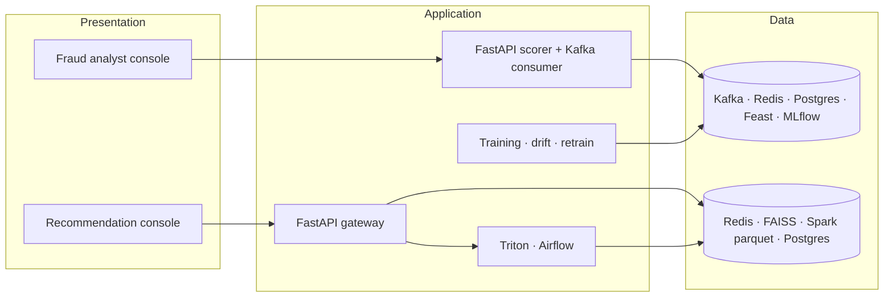

# AI/ML Specialization Track: Projects AIML-01 and AIML-03

Two production-style ML systems, each built as a **three-tier architecture**
(presentation, application and data tiers), with tests, CI, containers and Kubernetes
manifests.

| | [AIML-01 · Real-Time Fraud Detection](AIML-01/) | [AIML-03 · Two-Stage Recommendation Engine](AIML-03/) |
|---|---|---|
| **Problem** | Score live transactions for fraud in milliseconds, uncover fraud rings, support analysts | Recommend items from a large catalogue: fast candidate retrieval, then precise ranking |
| **Presentation tier** | Streamlit analyst console: alerts, case review with SHAP reasons, ring graph | Streamlit console: personalised feed, similar items, live A/B report |
| **Application tier** | FastAPI scorer + Kafka stream consumer + training pipeline + drift/retrain job | FastAPI gateway + Triton Inference Server + Airflow retraining DAG |
| **Data tier** | Kafka · Redis (online features) · PostgreSQL (cases/labels) · Feast · MLflow | Redis (cache) · FAISS (ANN index) · Spark feature tables · PostgreSQL (events) |
| **Models** | XGBoost + GraphSAGE (PyTorch Geometric), blended | TFRS two-tower retrieval + DCN-v2 / Wide & Deep rankers |
| **Headline result** | PR-AUC 0.96 (baseline 0.011), recall@P90 0.945, p99 1.4 ms | NDCG@10 +40% vs popularity, p99 6.7 ms, A/B with significance testing |
| **Tests** | 23 passing | 20 passing |



## Repository layout

```
.
├── AIML-01/        fraud detection platform  (README, docs/, src/, tests/, deploy/)
├── AIML-03/        recommendation engine     (README, docs/, src/, tests/, deploy/)
└── .github/        CI: lint + tests for both projects
```

## Run everything

```bash
# AIML-01
cd AIML-01 && pip install -e ".[dev,dashboard]" && make train test && make serve   # :8000/docs
# AIML-03
cd AIML-03 && pip install -e ".[dev,spark,ui]" && make train test ab && make serve  # :8100/docs
```

Each project's README covers architecture, installation, the full Docker Compose stack,
Minikube deployment, real-dataset instructions (PaySim / IEEE-CIS, MovieLens 25M) and a
milestone-by-milestone feature breakdown. Results and test reports are in each `docs/RESULTS.md`.
